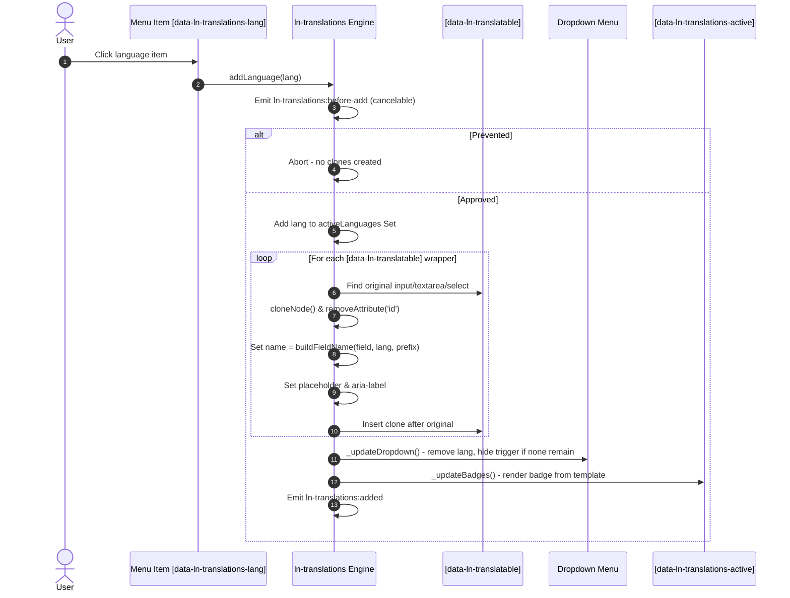

# ln-translations

> Applied to a form element (`<form data-ln-translations data-ln-translations-default="en">`). It coordinates translatable input containers (`[data-ln-translatable="field"]`), dynamically cloning the inner form controls with deterministic nested names (`trans[lang][field]`) when languages are added, and synchronizes active language badges and dropdown menus via `<template>` elements. It manages no network transport or validation, submitting cloned fields natively through the standard `<form>` submission pipeline.

A zero-dependency, event-driven **Form Translation Coordinator** that manages inline multi-lingual inputs by dynamically cloning translatable fields on-demand.

Instead of writing custom layout handlers to manage multi-language fields, this coordinator intercepts locale additions and removals, duplicates translatable fields with deterministic nested naming conventions, and handles pre-rendered server payloads automatically.

---

## 1. Core Behavior & Responsibility

- **Inline field cloning:** wraps translatable form fields via `data-ln-translatable`; when a language is activated (`addLanguage`), scans for translatable fields in the DOM, clones the wrapper's original `<input>`/`<textarea>`/`<select>` and appends the clone flagged with `data-ln-translatable-lang="{lang}"`.
- **Deterministic name generation:** cloned inputs get a nested array `name`, e.g. `trans[en][title]`, or `product[trans][en][title]` when the wrapper declares `data-ln-translations-prefix="product"`.
- **Menu & badge synchronization:** renders the available-language dropdown menu and the active-language badge list from two `<template>` elements (`ln-translations-menu-item`, `ln-translations-badge`), keeping both in sync on every add/remove.
- **Server-rendered hydration:** on init, scans the container for existing `[data-ln-translatable-lang]` elements and treats any language found there (other than the default) as already active, rebuilding the menu and badges accordingly — no `addLanguage()` call required.

The JavaScript source follows the Two-Tier Archetype: domain logic and algorithms are isolated in [translations-model.js](./src/translations-model.js), while the DOM coordinator shell is implemented in [ln-translations.js](./src/ln-translations.js).

> [!IMPORTANT]
> **What the component does NOT do (Orthogonality Doctrine):**
> - **Does NOT perform AJAX:** it only manipulates form fields in the DOM; submission is handled by the native `<form>` or `ln-form`.
> - **Does NOT open its own modals or dialogs:** the language menu is delegated to `ln-dropdown` + `ln-toggle`; the component never manages overlay state itself.
> - **Does NOT hardcode translatable field names or locale lists:** the active locales list is configurable via `data-ln-translations-locales` JSON or dictionary, and the translatable field names are declared via `data-ln-translatable` attributes.

---

## 2. Minimal HTML Markup & Usage Variants

### Base HTML Markup

```html
<form data-ln-translations data-ln-translations-default="en">
	<header>
		<h3>Company Info</h3>
		<div class="ln-translations__actions">
			<ul data-ln-translations-active></ul>
			<div data-ln-dropdown>
				<button type="button" data-ln-translations-add data-ln-toggle-for="trans-menu" aria-label="Add translation">
					<svg class="ln-icon" aria-hidden="true"><use href="#ln-icon-world"></use></svg>
				</button>
				<ul id="trans-menu" data-ln-toggle></ul>
			</div>
		</div>
	</header>

	<main>
		<div class="form-element">
			<label for="company-name">Name</label>
			<input type="text" id="company-name" name="name" value="Acme Corp">
		</div>

		<div class="form-element" data-ln-translatable="tagline">
			<label for="company-tagline">Tagline</label>
			<input type="text" id="company-tagline" name="tagline" value="Quality since 1990">
		</div>

		<div class="form-element" data-ln-translatable="scope" data-ln-translations-prefix="company">
			<label for="company-scope">Scope</label>
			<textarea id="company-scope" name="company[scope]">Food and beverage production</textarea>
		</div>
	</main>
</form>

<!-- Required global templates — declare once per page -->
<template data-ln-template="ln-translations-badge">
	<li>
		<p data-ln-translations-lang>
			<span></span>
			<button type="button" aria-label="Remove">
				<svg class="ln-icon ln-icon--sm" aria-hidden="true"><use href="#ln-icon-x"></use></svg>
			</button>
		</p>
	</li>
</template>

<template data-ln-template="ln-translations-menu-item">
	<li><button type="button" data-ln-translations-lang></button></li>
</template>
```

### Variant: Server-Rendered / Pre-Hydrated Translations

When translations are already rendered server-side, mark each pre-rendered field with `data-ln-translatable-lang="{lang}"`. On init the component scans for these attributes, treats every non-default language found as already active, and renders the matching menu/badge state — no `addLanguage()` call needed.

```html
<form data-ln-translations data-ln-translations-default="en">
	<main>
		<div class="form-element" data-ln-translatable="title">
			<label for="doc-title">Title</label>
			<input type="text" id="doc-title" name="title" value="Information Security">
			<input data-ln-translatable-lang="en" name="trans[en][title]" value="Information Security" placeholder="English translation">
		</div>
	</main>
</form>
```

---

## 3. Declarative API Contract (Attributes & Events)

### Attributes Table

| Attribute | Element | Type / Values | Default | Description |
|---|---|---|---|---|
| `data-ln-translations` | Container (`<form>`) | Marker | — | Initializes the translations coordinator on the container element. |
| `data-ln-translations-default` | Container | `String` | `""` | Default primary language code (e.g. `en`). Flags original translatable inputs on init. |
| `data-ln-translations-placeholder` | Container | `String` | `"{lang} translation"` | Placeholder label pattern for cloned translation inputs; `{lang}` is replaced with language display name. |
| `data-ln-translations-remove-label` | Container | `String` | `"Remove {lang}"` | Accessible label template for translation removal buttons; `{lang}` is replaced with language display name. |
| `data-ln-translations-locales` | Container | `JSON` | `{"en":"English","sq":"Shqip","sr":"Srpski"}` | JSON object mapping language codes to display labels. Auto-parsed via `attrJson`. |
| `data-ln-translations-dict` | Container | `String` | — | Dictionary key prefix mapping for translatable labels (`placeholder`, `remove-label`). |
| `data-ln-translations-menu` | Menu container | Marker | — | Explicit menu container holding available language buttons (inside or alongside `data-ln-dropdown`). |
| `data-ln-translations-active` | `<ul>` | Marker | — | Marks the mount container where active-language badges are rendered. |
| `data-ln-translations-add` | `<button>` | Trigger | — | Marks the trigger button that opens the language menu; hidden automatically once all languages are active. |
| `data-ln-translatable` | Field wrapper | `String` (field name) | — *(required)* | Marks a translatable field group; value is the field name used in generated `name` attributes. |
| `data-ln-translations-prefix` | Field wrapper | `String` | `""` | Optional name prefix for nested entities, e.g. `items[1]` produces `items[1][trans][en][title]`. |
| `data-ln-translatable-lang` | `<input>`, `<textarea>`, `<select>` | `String` (language code) | — | Marks a cloned or server-rendered translation field for a specific language. |
| `data-ln-translations-lang` | Inside templates | `String` (language code) | — *(required)* | Required anchor attribute inside both templates — populated with target language code and bindings. |

### Programmatic JS API

The initialized instance is exposed on the container element via `dom.lnTranslations`.

| Helper | Signature | Returns | Description |
|---|---|---|---|
| `dom.lnTranslations.addLanguage` | `(lang: String, values?: Object)` | `void` | Activates `lang`, clones translatable fields (optionally seeded with `values` keyed by field name), updates menu/badges, and dispatches add lifecycle events. |
| `dom.lnTranslations.removeLanguage` | `(lang: String)` | `void` | Deactivates `lang`, removes its cloned fields, updates menu/badges, and dispatches remove lifecycle events. |
| `dom.lnTranslations.hasLanguage` | `(lang: String)` | `Boolean` | Returns whether `lang` is currently active. |
| `dom.lnTranslations.getActiveLanguages` | `()` | `Set<String>` | Returns a new `Set` copy of the active languages. |
| `dom.lnTranslations.destroy` | `()` | `void` | Removes non-default clones, cleans auto-tagged attributes, detaches request listeners, and deletes instance. |

### Events API

| Event | Direction | Cancelable | Description | `detail` Object |
|---|---|---|---|---|
| `ln-translations:request-add` | Listens | No | Requests activation of a language programmatically. | `{ lang: String, values?: Object }` |
| `ln-translations:request-remove` | Listens | No | Requests deactivation of a language programmatically. | `{ lang: String }` |
| `ln-translations:before-add` | Emits | Yes | Fires before a language's fields are cloned. `preventDefault()` aborts activation. | `{ target: HTMLElement, lang: String, langName: String }` |
| `ln-translations:added` | Emits | No | Fires after a language's fields are cloned and menu/badges are updated. | `{ target: HTMLElement, lang: String, langName: String }` |
| `ln-translations:before-remove` | Emits | Yes | Fires before a language's cloned fields are removed. `preventDefault()` aborts removal. | `{ target: HTMLElement, lang: String }` |
| `ln-translations:removed` | Emits | No | Fires after a language's cloned fields are removed and menu/badges are updated. | `{ target: HTMLElement, lang: String }` |

---

## 4. CSS Styling & Behavioral Concept

`ln-translations` co-locates production SCSS: reusable mixins in `theme/config/mixins/_translations.scss` and selector bindings in `theme/components/_translations.scss`.

- **Per-language flag icons (CSS data-driven):** every `[data-ln-translatable-lang]` field, active badge, and dropdown button gets a flag icon keyed by ISO 639-1 -> ISO 3166-1 country lookup (`/assets/flags/{country}.svg`).
- **CSS Logical Properties:** spacing and positioning use `padding-inline-start`, `margin-inline-start`, and `padding-block`.
- **Cloning semantics:** `cloneNode(false)` is used for translatable inputs/textareas and `cloneNode(true)` for selects. Duplicate `id` attributes are explicitly stripped (`removeAttribute('id')`).

---

## 5. Accessibility (ARIA) & Common Pitfalls

- **Dynamic labels & placeholders:** cloned fields receive `placeholder` and `aria-label` matching `{langName} translation` (e.g. `English translation`), and badge remove buttons carry `aria-label="Remove {langName}"`.
- **Keyboard-native controls:** all interactive items (dropdown items, triggers, badge close buttons) are native `<button type="button">`.
- **Missing Templates Warning:** without both global `<template data-ln-template="ln-translations-badge">` and `<template data-ln-template="ln-translations-menu-item">` present on the page, `cloneTemplateScoped` returns `null` and badges/menu items cannot render.

---

## 6. Sequence & Lifecycle Flow



---

## 7. Related Components & Coordinators

- [`ln-form`](../ln-form/README.md) — submits the generated `trans[lang][field]` fields as standard native form data.
- [`ln-dropdown`](../ln-dropdown/README.md) — provides dropdown menu positioning and dismissal behavior for language selection.
- [`ln-toggle`](../ln-toggle/README.md) — binary open/close state primitive that `ln-dropdown` coordinates.
- [`ln-validate`](../ln-validate/README.md) — validates cloned translation fields according to standard HTML constraints.
