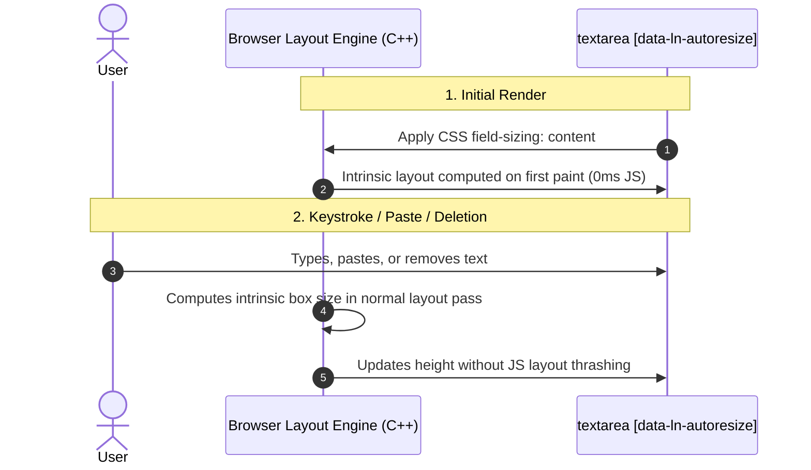

# ↕️ ln-autoresize

> Applied directly to a `<textarea data-ln-autoresize rows="1">`. It leverages native CSS `field-sizing: content` to automatically expand and collapse textarea height according to its content volume directly in the browser's C++ rendering engine. It carries zero JavaScript runtime overhead, zero event listeners, and zero layout thrashing.

---

## 1. Core Behavior & Responsibility

- **Core Role:** Dynamically adjusts the vertical height of HTML `<textarea>` elements to fit their content intrinsically, eliminating vertical scroll bars and unnecessary white space.
- **Pure CSS Execution:** Driven entirely by native CSS (`field-sizing: content`), eliminating legacy forced reflows (`scrollHeight` reading) and main-thread freezing.
- **Zero-JS Lifecycle:** Textarea boxes size accurately on first paint with pre-filled server text, expand smoothly during typing/paste, and collapse immediately on delete or form reset.
- Located in [`theme/components/_form.scss`](../../theme/components/_form.scss) and [`theme/config/mixins/_form.scss`](../../theme/config/mixins/_form.scss).

> [!IMPORTANT]
> **What the utility does NOT do (Orthogonality Doctrine):**
> - **Does NOT attach JavaScript event listeners** — Sizing is handled natively in the browser's layout pass.
> - **Does NOT validate input lengths** — Form validation is handled by [`ln-validate`](./ln-validate.md).
> - **Does NOT manage form submissions** — Form data flow is handled by [`ln-form`](./ln-form.md).

---

## 2. Minimal HTML Markup & Usage Variants

### Base HTML Markup

Standard implementation for an auto-growing textarea:

```html
<textarea data-ln-autoresize rows="1" placeholder="Write text..."></textarea>
```

---

### Variant 1: Pre-populated Form Data (SSR / Edit Modes)

When data is loaded or pre-rendered by the server, native CSS intrinsically computes the accurate layout height on initial paint:

```html
<div class="form-element">
    <label for="description">Detailed Description:</label>
    <textarea id="description" 
              name="description" 
              data-ln-autoresize
              rows="3">This is a long pre-populated description. The textarea intrinsically sizes to ensure all text is readable without extra script execution.</textarea>
</div>
```

---

### Variant 2: Capped Growth with Overflow Scroll

To set an upper ceiling and allow scrolling once content exceeds a specific height, pair the attribute with standard CSS `max-height`:

```html
<div class="form-element">
    <label for="capped-notes">Notes (max 6rem):</label>
    <textarea id="capped-notes" data-ln-autoresize rows="1" style="max-height: 6rem; overflow-y: auto;"></textarea>
</div>
```

---

## 3. Declarative API Contract (Attributes & Events)

### Attributes Table

| Attribute | Element | Type / Values | Default | Description |
|---|---|---|---|---|
| `data-ln-autoresize` | `<textarea>` | marker | — | Activates native CSS `field-sizing: content` and resets manual resize handles. |
| `rows` | `<textarea>` | integer | `1` | Defines the baseline row height when empty. Recommended: `1`. |

### Events API

This utility is 100% pure CSS and does not listen to or emit custom events.

---

## 4. CSS Styling & Behavioral Concept

### Built-in CSS Definition

Ashlar includes the following styling in `_form.scss`:

```scss
textarea[data-ln-autoresize] {
    field-sizing: content;
    min-height: unset;
    resize: none;
}
```

### Height Capping & Styling Guidelines

Ceilings are authored using standard CSS constraints:

```scss
.my-form textarea[data-ln-autoresize] {
    max-height: 8rem;
    overflow-y: auto;
}
```

> [!NOTE]
> `resize: none` is automatically set by Ashlar for `[data-ln-autoresize]` to prevent conflicts between native auto-expansion and user drag handles.

---

## 5. Accessibility (ARIA) & Common Pitfalls

### ARIA & Keyboard Semantics

- **Native Textareas:** Standard accessibility semantics, keyboard focus, and screen reader announcements remain untouched and 100% native.

### Common Pitfalls & Anti-patterns

> [!CAUTION]
> 1. **Applying to Unsupported Elements:**
>    Placing `data-ln-autoresize` on non-textarea elements (`<input>`, `<div>`) triggers a dev-time warning from `ln-form-dev.scss`.
> 2. **Forgetting `rows="1"`:**
>    Textareas default to `rows="2"`. To ensure compact single-row inputs when empty, always declare `rows="1"`.

---

## 6. Sequence & Lifecycle Flow



---

## 7. Related Components & Coordinators

- [`ln-form.md`](./ln-form.md) — Standard wrapping form context.
- [`ln-validate.md`](./ln-validate.md) — Field validation on input and blur.
- [`ln-modal.md`](./ln-modal.md) — Compact dialogs and modal forms.
