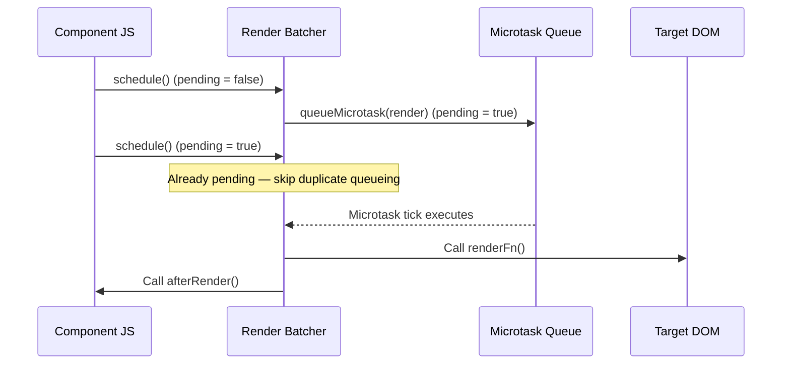

# ⚡ ln-reactive

> **Classification:** ⚙️ Service (Layer 3 - Reactive State & Rendering Optimization)

---

## 1. Core Behavior & Responsibility

`ln-reactive` provides a microtask-based render batcher (`createBatcher`) to coalesce multiple synchronous state changes into a single DOM render pass, preventing redundant renders and layout thrashing.

The JavaScript source is located at [reactive.js](../../components/ln-core/reactive.js).

Key responsibilities include:
- **Microtask Render Batcher (`createBatcher`):** Batches multiple synchronous state mutations into a single DOM render cycle using `queueMicrotask`.
- **Render Coalescing:** Multiple calls to `schedule()` within the same synchronous execution block execute `renderFn` exactly once.
- **After-Render Hook:** Dispatches notification events or post-render callbacks through the optional `afterRender` handler.

> [!IMPORTANT]
> **What the module does NOT do (Orthogonality Doctrine):**
> - **Virtual DOM Diffing:** `ln-reactive` does not diff virtual DOM trees. Component rendering callbacks update target DOM nodes directly (`fill`, `renderList`).
> - **Global Store Management:** It is a low-level scheduler primitive, not a centralized store architecture (use [`ln-data-store`](./ln-data-store.md) for domain data stores).

---

## 2. Minimal HTML Markup & Usage Variants

`ln-reactive` is a pure JavaScript utility module imported directly into components:

```javascript
import { createBatcher } from '../../ln-core';

// 1. Create a render batcher
const scheduleRender = createBatcher(
    () => {
        self._render();
    },
    () => {
        self.dom.dispatchEvent(new CustomEvent('ln-component:rendered', { bubbles: true }));
    }
);

// 2. Synchronous calls trigger only ONE scheduled render pass
scheduleRender();
scheduleRender();
scheduleRender();
```

---

## 3. Declarative API Contract (Attributes & Events)

### Attributes Table

This service module exposes no declarative HTML attributes directly.

### Programmatic JS API

| Helper | Signature | Returns | Description |
|---|---|---|---|
| `createBatcher` | `(renderFn: Function, afterRender?: Function)` | `Function` | Returns a `schedule()` function that queues `renderFn` and optional `afterRender` on the microtask queue. Multiple calls within the same tick execute `renderFn` exactly once. |

### Events API

This service module emits and listens to no custom DOM events directly.

---

## 4. Performance & Batching Concept

When multiple properties change sequentially in a synchronous block (e.g., search input, filter checkboxes, sorting), executing DOM writes for every change causes layout thrashing.

`createBatcher` uses `queueMicrotask` to coalesce state operations:

```
[Sync Update A] ──┐
[Sync Update B] ──┼──> queueMicrotask ──> [ single renderFn() ]
[Sync Update C] ──┘
```

---

## 5. Flow Diagram & Lifecycle



---

## 6. Related Components

- [`ln-core`](./ln-core.md) — Re-exports `createBatcher`.
- [`ln-search`](./ln-search.md) — Uses `createBatcher` to batch apply operations.
- [`ln-filter`](./ln-filter.md) — Uses `createBatcher` to debounce filter execution.
- [`ln-list`](./ln-list.md) — Uses `createBatcher` for virtualized sparse window updates.
