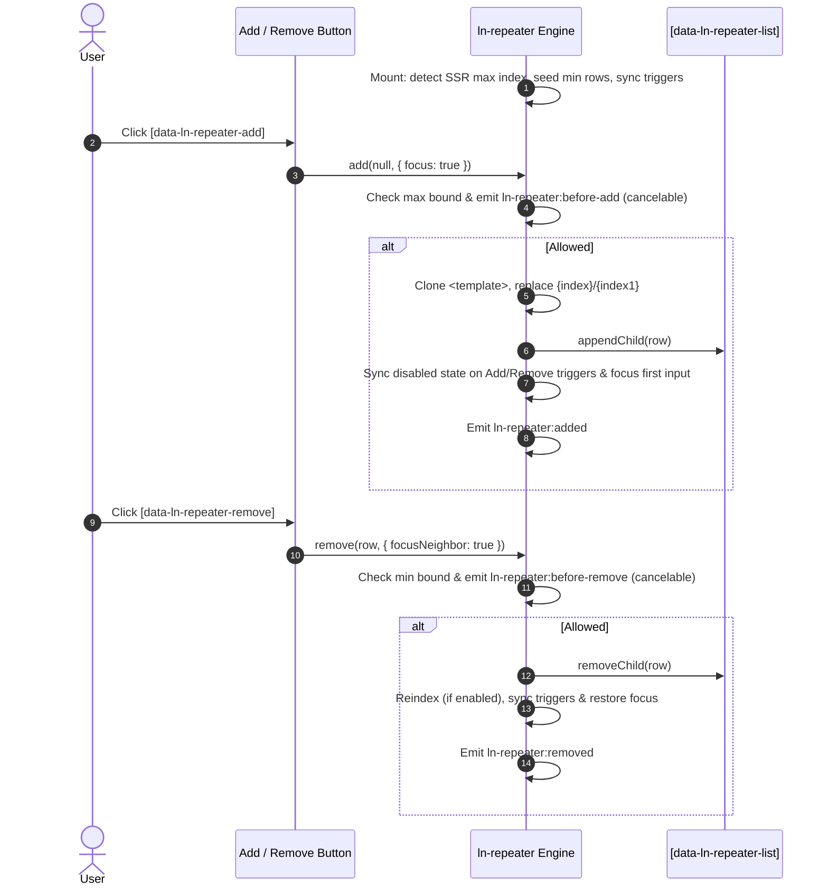

# 🔁 ln-repeater

> **Classification:** 🟢 Simple Component / Dynamic Form-Row Primitive  
> Applied to a container (`data-ln-repeater="name"`) wrapping a list (`[data-ln-repeater-list]`), add/remove triggers (`[data-ln-repeater-add]`, `[data-ln-repeater-remove]`), and a `<template>` defining one row. It clones rows from the `<template>`, substitutes `{index}`/`{index1}` placeholders, enforces `data-ln-repeater-min`/`max` bounds via native `disabled` state, and hydrates rows from `ln-fill` array payloads. Native form controls inside each row remain the single source of truth for form submission — zero hidden inputs, zero JS data mirrors, and zero sibling component coupling.

---

## 1. Core Behavior & Responsibility

- **Template-driven row cloning:** Clones authored `<template>` markup (scoped local template first, then global `[data-ln-template="<name>"]`, or an anonymous local `<template>` when bare). Zero JS DOM construction and zero hardcoded display strings.
- **Monotonic & sequential indexing:** Replaces `{index}` (0-based) and `{index1}` (1-based) in attributes and text nodes. Monotonic by default (safe for backend IDs and server-rendered rows via automatic max-index detection); opt-in sequential renumbering on remove or `ln-sortable:reordered` via `data-ln-repeater-reindex`.
- **Declarative bounds (`min` / `max`):** Auto-seeds `min` rows on mount when the list starts empty, disables `[data-ln-repeater-remove]` when `count <= min`, and disables internal/external add triggers when `count >= max`.
- **Edit/Create hydration (`ln-fill`):** Automatically listens for `ln-fill` on the repeater and its enclosing `<form>`: populates rows from `record[templateName]` (supports both primitive arrays like `["Red", "Blue"]` and object arrays like `[{ label: "Red", weight: 12 }]`, or JSON strings thereof), and resets cleanly to `min` empty rows on `null`.
- **Accessible focus management:** Clicking add moves focus to the first focusable control in the new row; clicking remove moves focus to a neighboring row (or the add trigger) so keyboard users never lose focus to `<body>`.

The JavaScript source follows the Two-Tier Archetype: pure algorithms live in [repeater-model.js](../../components/ln-repeater/src/repeater-model.js), while the DOM shell lives in [ln-repeater.js](../../components/ln-repeater/src/ln-repeater.js).

> [!IMPORTANT]
> **Orthogonality Doctrine (What the component does NOT do):**
> - **Does NOT manage translations directly:** Compose [`ln-translations`](./ln-translations.md) on the enclosing `<form>` and place `[data-ln-translatable]` inside the row `<template>` — `ln-translations` automatically syncs active languages onto newly added rows.
> - **Does NOT implement drag-and-drop:** Add `data-ln-sortable` to `[data-ln-repeater-list]` and `data-ln-sortable-handle` inside the template row to compose [`ln-sortable`](./ln-sortable.md).
> - **Does NOT perform validation or AJAX:** Native HTML5 constraints work with [`ln-validate`](./ln-validate.md), and standard form submission works with [`ln-form`](./ln-form.md) / [`ln-ajax`](./ln-ajax.md).

---

## 2. Minimal HTML Markup & Usage Variants

### Base HTML Markup (Single-Field Repeater with `min="1"`)

```html
<div data-ln-repeater="options" data-ln-repeater-min="1" data-ln-repeater-max="20">
	<ul data-ln-repeater-list></ul>

	<button type="button" data-ln-repeater-add>Add option</button>

	<template data-ln-template="options">
		<li data-ln-repeater-item>
			<input type="text" name="options[]" required aria-label="Option {index1}">
			<button type="button" data-ln-repeater-remove aria-label="Remove option">
				<svg class="ln-icon" aria-hidden="true"><use href="#ln-icon-x"></use></svg>
			</button>
		</li>
	</template>
</div>
```

### Variant 1: Translatable & Sortable Option Rows (`ln-translations` + `ln-sortable`)

When `[data-ln-translatable]` sits inside `[data-ln-repeater-item]`, `ln-repeater`'s theme mixin automatically lays out language inputs side-by-side in flex, and `ln-translations` automatically clones all active languages onto newly appended rows:

```html
<form data-ln-form data-ln-translations data-ln-translations-default="en" data-ln-translations-locales='{"en":"English","de":"Deutsch","mk":"Македонски"}'>
	<div data-ln-repeater="options" data-ln-repeater-min="1">
		<ul data-ln-repeater-list data-ln-sortable></ul>

		<button type="button" data-ln-repeater-add>Add option</button>

		<template data-ln-template="options">
			<li data-ln-repeater-item>
				<span data-ln-sortable-handle aria-hidden="true">⋮⋮</span>
				<div data-ln-translatable="label" data-ln-translations-prefix="options[{index}]">
					<input type="text" name="options[{index}][label]" required>
				</div>
				<button type="button" data-ln-repeater-remove aria-label="Remove option">×</button>
			</li>
		</template>
	</div>
</form>
```

### Variant 2: Multi-Field Indexed Rows with Sequential Reindexing & External Add Trigger

```html
<header>
	<h3>Sacks</h3>
	<button type="button" data-ln-repeater-add-for="sacks-repeater">Add sack</button>
</header>

<div id="sacks-repeater" data-ln-repeater="sacks" data-ln-repeater-min="1" data-ln-repeater-reindex>
	<ul data-ln-repeater-list data-ln-sortable></ul>

	<template data-ln-template="sacks">
		<li data-ln-repeater-item>
			<span data-ln-sortable-handle aria-hidden="true">⋮⋮</span>
			<select name="sacks[{index}][type]" required>
				<option value="standard">Standard</option>
				<option value="window">Window</option>
			</select>
			<input type="number" name="sacks[{index}][weight]" step="0.1" min="0" required>
			<input type="number" name="sacks[{index}][qty]" min="1" value="1" required>
			<button type="button" data-ln-repeater-remove aria-label="Remove row">×</button>
		</li>
	</template>
</div>
```

---

## 3. Declarative API Contract (Attributes & Events)

### Attributes Table

| Attribute | Element | Type / Values | Default | Description |
|---|---|---|---|---|
| `data-ln-repeater` | Root container | `string` | `""` | Initializes the repeater. Optional value names the `<template data-ln-template="...">` and the `ln-fill` array key. |
| `data-ln-repeater-min` | Root container | `integer` (`>= 0`) | `0` | Minimum number of rows; auto-seeds on init when empty and disables remove buttons at `count <= min`. |
| `data-ln-repeater-max` | Root container | `integer` (`>= 1`) | `Infinity` | Maximum number of rows; disables internal/external add triggers once reached. |
| `data-ln-repeater-reindex` | Root container | `boolean` | `false` | When enabled, re-numbers `{index}`/`{index1}` attributes sequentially after remove or `ln-sortable:reordered`. |
| `data-ln-repeater-list` | `<ul>` / `<ol>` / container | marker | — | List container where repeated items live. Falls back to root if omitted. |
| `data-ln-repeater-item` | Row element | marker | — | Marks an individual repeated row (applied automatically to cloned rows if omitted). |
| `data-ln-repeater-add` | `<button type="button">` | trigger | — | Internal button that appends a new row. |
| `data-ln-repeater-add-for` | `<button type="button">` | `string` (ID) | — | External trigger targeting a repeater container by `id`. |
| `data-ln-repeater-remove` | `<button type="button">` | trigger | — | Per-row button that removes its owning item. |

### Programmatic JS API

Accessed via `element.lnRepeater`:

| Member | Signature | Returns | Description |
|---|---|---|---|
| `element.lnRepeater.items` | getter | `HTMLElement[]` | Live array of current row elements. |
| `element.lnRepeater.count` | getter | `number` | Current number of rows. |
| `element.lnRepeater.add` | `(values?, options?)` | `HTMLElement \| null` | Appends a cloned row, optionally populating fields from `values`. |
| `element.lnRepeater.remove` | `(itemOrIndex, options?)` | `boolean` | Removes a row by element or 0-based position unless blocked by `min` or prevented. |
| `element.lnRepeater.clear` | `(options?)` | `void` | Removes rows down to `min` (or all rows when `{ force: true }`). |
| `element.lnRepeater.destroy` | `()` | `void` | Detaches listeners, resets `disabled`/`aria-disabled` on triggers, and deletes `element.lnRepeater`. |

### Events API

All emitted events bubble from the repeater root (`{ bubbles: true }`):

| Event | Direction | Cancelable | Description | `detail` Object |
|---|---|---|---|---|
| `ln-repeater:request-add` | Listens | No | Requests appending a new row on the repeater root. | `{ values?: Object\|string\|null, focus?: boolean }` |
| `ln-repeater:request-remove` | Listens | No | Requests removing a row by element or 0-based position on the repeater root. | `{ item?: HTMLElement, index?: number, focusNeighbor?: boolean }` |
| `ln-fill` | Listens | No | Hydrates rows from `detail[templateName]` (array or JSON array string), or clears and re-seeds `min` rows when `detail` is `null`. | `Object \| null` |
| `ln-repeater:before-add` | Emits | Yes | Fires before a row is cloned and appended. `preventDefault()` aborts the addition. | `{ target: HTMLElement, index: number, count: number }` |
| `ln-repeater:added` | Emits | No | Fires after a row is appended and controls are synced. | `{ target: HTMLElement, item: HTMLElement, index: number, count: number }` |
| `ln-repeater:before-remove` | Emits | Yes | Fires before a row is removed. `preventDefault()` aborts the removal. | `{ target: HTMLElement, item: HTMLElement, index: number, count: number }` |
| `ln-repeater:removed` | Emits | No | Fires after a row is removed and controls are synced. | `{ target: HTMLElement, item: HTMLElement, index: number, count: number }` |
| `ln-repeater:reindexed` | Emits | No | Fires after sequential reindexing completes (only when `data-ln-repeater-reindex` is active). | `{ target: HTMLElement, count: number }` |
| `ln-repeater:max-reached` | Emits | No | Fires when an add attempt is blocked by `data-ln-repeater-max`. | `{ target: HTMLElement, max: number, count: number }` |
| `ln-repeater:min-reached` | Emits | No | Fires when a remove attempt is blocked by `data-ln-repeater-min`. | `{ target: HTMLElement, min: number, count: number }` |

---

## 4. CSS Styling & Behavioral Concept

- **Functional CSS ([ln-repeater.scss](../../components/ln-repeater/ln-repeater.scss)):** Strips list bullets/margins on `[data-ln-repeater-list]`, applies flex row alignment on `[data-ln-repeater-item]`, and disables pointer events on `:disabled` triggers.
- **Theme Mixin ([_repeater.scss](../../theme/config/mixins/_repeater.scss) & [_repeater.scss](../../theme/components/_repeater.scss)):**
  - Vertical stack with `var(--size-sm)` gap between rows and add trigger.
  - Direct controls and `.form-element` children expand equally (`flex: 1 1 0; min-width: 0;`), while remove buttons and `[data-ln-sortable-handle]` stay fixed-width (`flex-shrink: 0`).
  - **Side-by-side translations:** `[data-ln-translatable]` inside `[data-ln-repeater-item]` switches to horizontal wrapping flex (`flex-wrap: wrap; gap: var(--size-sm)`) and resets `margin-block-start: 0` on sibling `[data-ln-translatable-lang]` inputs so added languages appear inline beside the default input.
  - Remove button uses `@include btn-ghost` aligned to input height with `hsl(var(--color-error))` hover feedback.
- **Dev Diagnostics ([ln-repeater-dev.scss](../../components/ln-repeater/ln-repeater-dev.scss)):** Under `[data-ln-debug]`, flags orphaned sub-elements, buttons inside `<form>` missing `type="button"`, and bare repeaters without a local `<template>`.

---

## 5. Accessibility (ARIA) & Common Pitfalls

### ARIA & Keyboard Mechanics

- **Explicit `type="button"`:** Always set `type="button"` on `[data-ln-repeater-add]`, `[data-ln-repeater-add-for]`, and `[data-ln-repeater-remove]` so pressing Enter in a form does not trigger accidental removal or form submission.
- **Accessible remove buttons:** Icon-only remove triggers MUST include a clear `aria-label` (e.g. `aria-label="Remove option"`).
- **Focus continuity:** User clicks on Add focus the first enabled control in the new row; user clicks on Remove move focus to a remaining row (or the Add trigger) instead of dropping focus to `<body>`.
- **Unique IDs:** If your `<template>` contains `<label for="...">` + `<input id="...">`, include `{index}` in both (`id="opt-{index}"` and `for="opt-{index}"`). Any static duplicate `id` on cloned rows is stripped automatically.

### Common Pitfalls & Anti-patterns

> [!CAUTION]
> 1. **Omitting `type="button"` inside `<form>`:** Native `<button>` defaults to `type="submit"`, causing Add/Remove clicks or Enter key presses to submit the form prematurely.
> 2. **Using `data-ln-repeater-reindex` with server-persisted keyed translations:** Monotonic indices (the default) prevent backend key collisions when deleting middle rows; enable `data-ln-repeater-reindex` only when sequential `0..n-1` indices are explicitly required.
> 3. **Nesting `<form>` inside a repeater row:** Never nest `<form>` inside `<form>`. Repeated rows belong inside a single parent `<form>`.

---

## 6. Sequence & Lifecycle Flow



---

## 7. Related Components & Coordinators

- [`ln-translations`](./ln-translations.md) — Automatically clones active language inputs into dynamically added repeater rows containing `[data-ln-translatable]`.
- [`ln-sortable`](./ln-sortable.md) — Adds drag-and-drop row reordering directly onto `[data-ln-repeater-list]`.
- [`ln-fill`](./ln-fill.md) — Hydrates repeater rows from record arrays on Edit modal open and resets to `min` rows on `null`.
- [`ln-form`](./ln-form.md) — Submits all repeated row controls natively alongside standard form fields.
- [`ln-validate`](./ln-validate.md) — Validates required/constrained controls inside cloned repeater rows.
